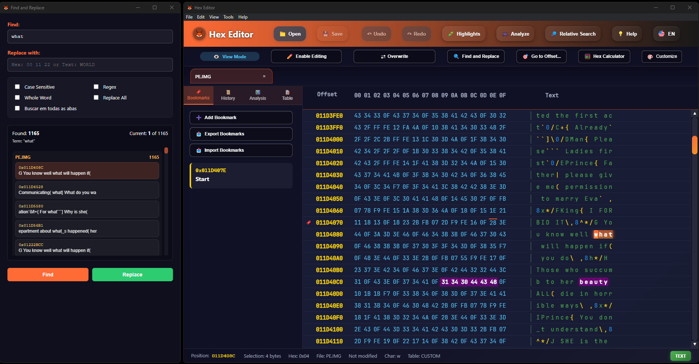
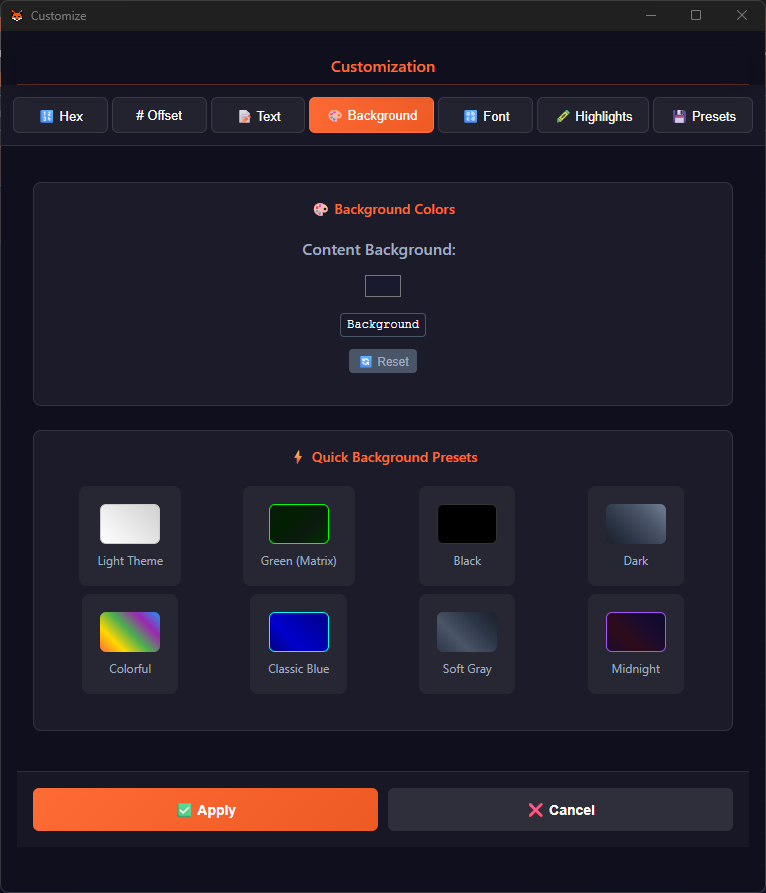
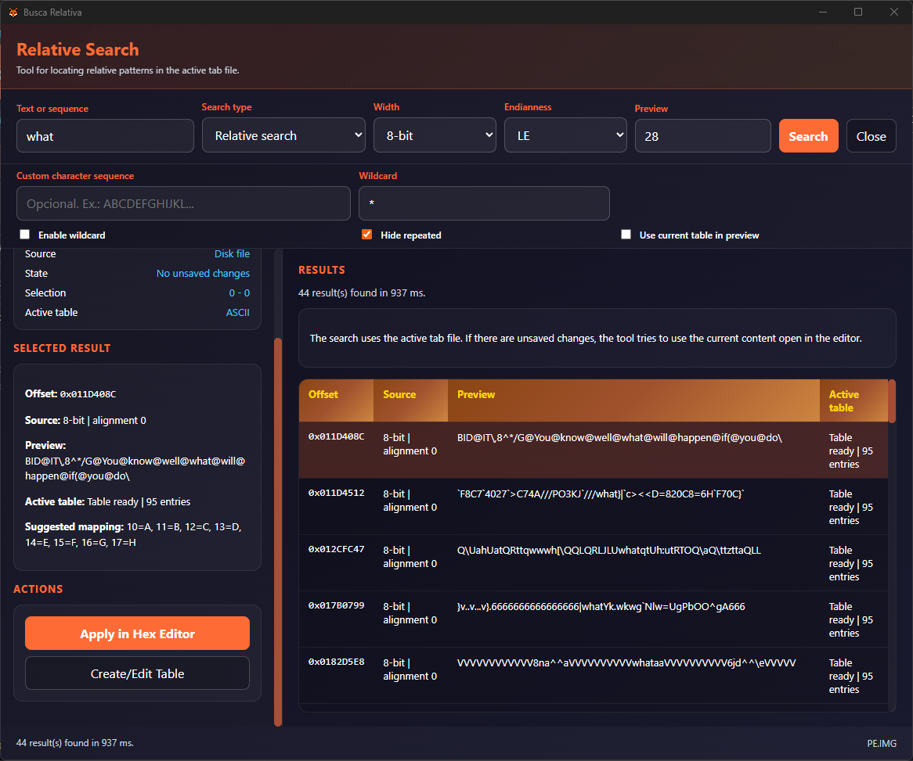
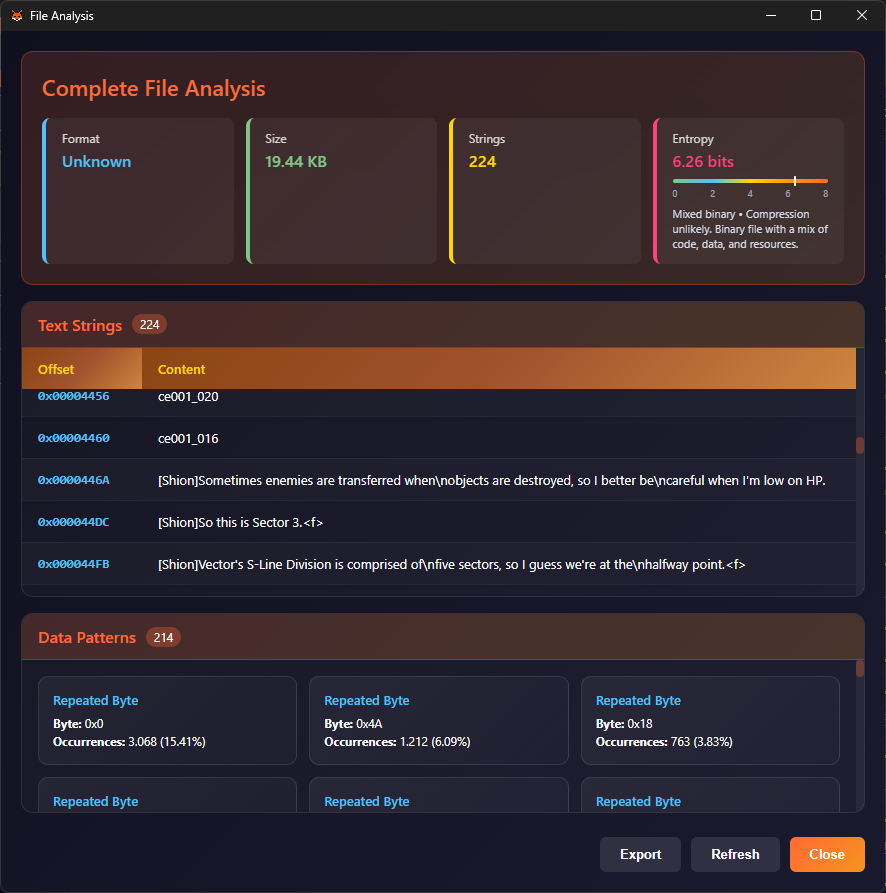
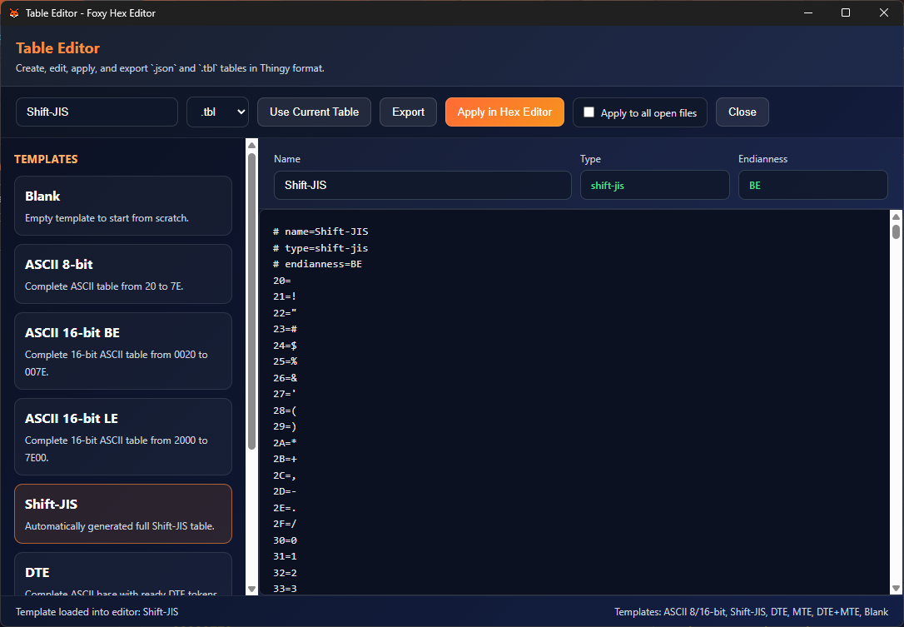

# [🇺🇸 English](README.en.md) | [🇧🇷 Português](README.md)

<p align="center">
  
</p>

<h1 align="center">Foxy Hex Editor</h1>

<p align="center">
  <strong>Hexadecimal Editor for translation and ROM hacking.</strong>
</p>

<p align="center">
  
  
  
</p>

---



## 📸 Screenshots
<p align="center">
  <br><br>
  <br><br>
  <br><br>
  
</p>

## 🦊 About the Project
**Foxy Hex Editor** was designed specifically for the needs of the translation and ROM hacking communities. Developed with **HTML5, CSS3, and JavaScript** on the **Electron** framework, it combines the precision of low-level binary editing with a modern interface and tools.

## ✨ Highlights
- 🚀 **100% Portable**: No files scattered across the system. Everything stays in the app folder.
- ⚡ **Huge Files**: Open files of 50GB or more instantly through the virtual rendering engine.
- 🗂️ **Multiple Tabs**: Work on several files simultaneously. Each tab is independent and preserves its own character table, bookmarks, and cursor position.
- 🌍 **Character Mapping**: Robust support for 8 and 16-bit (.tbl and .json) tables (BE/LE). Decodes advanced ROM hacking patterns like DTE, MTE, Shift-JIS, and custom tags.
- 🧮 **Hex Calculator**: An integrated tool for offset calculations and quick conversions.
- 🔍 **Smart Search**: Support for Hex, Text, and Regular Expressions (Regex).
- 🔍 **Relative Search**: Locate text in files without standard encoding (ASCII/Unicode). Identifies patterns based on the numerical distance between bytes and assists in automated character table (.tbl) creation.
- 📊 **ROM Analysis**: Quickly identify patterns, data sections, and entropy. Detects known compression signatures (Yaz0, RNC, LZ77, zlib, and more).
- 🎨 **Full Customization**: Adjust background colors, text, and bytes individually. Change fonts and sizes to create a tailored workspace.

## 💻 System Requirements

| Component               | Minimum Requirement        | Recommended                  |
| ----------------------- | -------------------------- | ---------------------------- |
| 🖥️ **Operating System** | Windows 10 / Ubuntu 20.04+ | Windows 10/11 / Ubuntu 22.04+ |
| 🏎️ **Processor**        | Dual Core 1.5GHz           | Quad Core 2.0GHz+            |
| 🧠 **Memory (RAM)**     | 2 GB                       | 4 GB or more                 |
| 💾 **Disk Space**       | 200 MB free                | 500 MB (SSD)                 |
| 🏗️ **Architecture**     | x64                        | x64                          |

## 📥 Downloads
You can find pre-compiled versions in the **Releases** section of the repository:

- 🪟 **Windows**: Portable version (.exe).
- 🐧 **Linux**: AppImage (works on almost all distros).

> [!TIP]
> **[Click here to download the latest version](https://github.com/rquinalha/Foxy-Hex-Editor/releases/tag/v1.0.0)**

## 🚀 How to Run and Configure
 
To ensure the app runs perfectly on your system:

### 🪟 Windows
1. **Recommended Version**: Windows 10 or higher (64-bit).
2. **Executable**: Simply download the `.exe` from the Releases section and run it. It is 100% portable.
3. **Development**:
   - Install [Node.js LTS](https://nodejs.org/).
   - Clone the repo and run:
     ```powershell
     npm install
     npm start
     ```

### 🐧 Linux
1. **AppImage**: If you are using modern distros (like Ubuntu 22.04+), you may need to install `libfuse2`:
   ```bash
   sudo apt install libfuse2
   ```
2. **Permissions**: Give the AppImage execution permission:
   ```bash
   chmod +x Foxy-Hex-Editor.AppImage
   ./Foxy-Hex-Editor.AppImage
   ```
3. **Development**:
   - Ensure you have Electron's dependencies installed (libnss3, libatk, etc).
   - Clone and run:
     ```bash
     npm install
     npm start
     ```

## 🛠️ How to Build
If you wish to generate your own binaries:

1. Install [Node.js](https://nodejs.org/).
2. On **Windows**, you can use the helper script:
   - Run `build.bat` and choose the desired option.
3. On **Linux** or via Terminal:
   - `npm run dist` (Generates all configured packages)
   - `npm run appimage` (Generates only the AppImage for Linux)

## 🤝 Contribution
Contributions are always welcome! Feel free to open an *Issue* or send a *Pull Request*.

---

<p align="center">
  Developed for the translation community.
</p>
