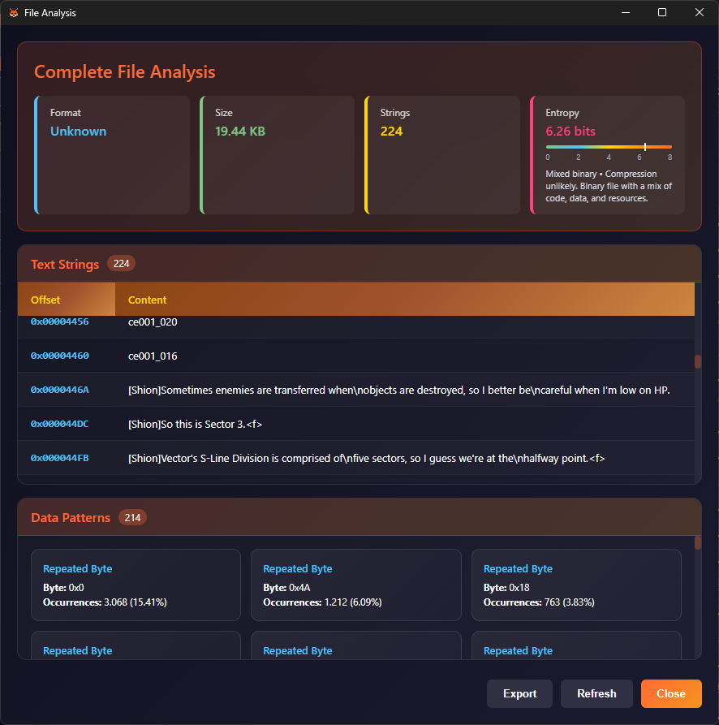

# [🇺🇸 English](README.en.md) | [🇧🇷 Português](README.md)

<p align="center">
  
</p>

<h1 align="center">Foxy Hex Editor</h1>

<p align="center">
  <strong>Editor Hexadecimal para tradução e ROM hacking.</strong>
</p>

<p align="center">
  
  
  
</p>

---


## 📸 Screenshots
<p align="center">
  <br><br>
  <br><br>
  <br><br>
  
</p>

## 🦊 Sobre o Projeto
**Foxy Hex Editor** foi desenhado especificamente para as necessidades das comunidades de tradução e ROM hacking. Desenvolvido com **HTML5, CSS3 e JavaScript** sobre o framework **Electron**, ele combina a precisão da edição binária de baixo nível com uma interface moderna e ferramentas.

## ✨ Destaques
- 🚀 **100% Portável**: Não espalha arquivos pelo sistema. Tudo fica na pasta do app.
- ⚡ **Arquivos Gigantes**: Abra arquivos de 50GB ou mais instantaneamente através do motor de renderização virtual.
- 🗂️ **Múltiplas Abas**: Trabalhe em diversos arquivos simultaneamente. Cada aba é independente e preserva sua própria tabela de caracteres, favoritos e posição do cursor.
- 🌍 **Mapeamento de Caracteres**: Suporte robusto a tabelas (.tbl e .json) de 8 e 16 bits (BE/LE). Decodifica padrões avançados de ROM hacking como DTE, MTE, Shift-JIS e tags customizadas.
- 🧮 **Calculadora Hex**: Uma ferramenta integrada para cálculos de offsets e conversões rápidas.
- 🔍 **Busca Inteligente**: Suporte a Hex, Texto e Expressões Regulares (Regex).
- 🔍 **Busca Relativa**: Localize textos em arquivos sem codificação padrão (ASCII/Unicode). Identifica padrões baseados na distância numérica entre bytes e auxilia na criação automatizada de tabelas de caracteres (.tbl).
- 📊 **Análise de ROM**: Identifique rapidamente padrões, seções de dados e entropia. Detecta assinaturas de compressão conhecidas (Yaz0, RNC, LZ77, zlib e mais).
- 🎨 **Personalização Completa**: Ajuste cores de fundo, texto e bytes individualmente. Altere fontes e tamanhos para criar um ambiente de trabalho sob medida.

## 💻 Requisitos do Sistema

| Componente                | Requisito Mínimo            | Recomendado                  |
| ------------------------- | --------------------------- | ---------------------------- |
| 🖥️ **Sist. Operacional** | Windows 10 / Ubuntu 20.04+  | Windows 10/11 / Ubuntu 22.04+ |
| 🏎️ **Processador**       | Dual Core 1.5GHz            | Quad Core 2.0GHz+            |
| 🧠 **Memória RAM**       | 2 GB                        | 4 GB ou mais                 |
| 💾 **Espaço em Disco**   | 200 MB livre                | 500 MB (SSD)                 |
| 🏗️ **Arquitetura**       | x64                         | x64                          |

## 📥 Downloads
Você pode encontrar as versões pré-compiladas na seção de **Releases** do repositório:

- 🪟 **Windows**: Versão portável (.exe).
- 🐧 **Linux**: AppImage (funciona em quase todas as distros).

> [!TIP]
> **[Clique aqui para baixar a versão mais recente](https://github.com/rquinalha/Foxy-Hex-Editor/releases/tag/v1.0.0)**

## 🚀 Como Rodar e Configurar

Para garantir que o app funcione perfeitamente no seu sistema:

### 🪟 Windows
1. **Versão Recomendada**: Windows 10 ou superior (64-bit).
2. **Executável**: Basta baixar o `.exe` na seção de Releases e rodar. É 100% portável.
3. **Desenvolvimento**:
   - Instale o [Node.js LTS](https://nodejs.org/).
   - Clone o repo e rode:
     ```powershell
     npm install
     npm start
     ```

### 🐧 Linux
1. **AppImage**: Se estiver usando distros modernas (como Ubuntu 22.04+), você pode precisar instalar a `libfuse2`:
   ```bash
   sudo apt install libfuse2
   ```
2. **Permissões**: Dê permissão de execução ao AppImage:
   ```bash
   chmod +x Foxy-Hex-Editor.AppImage
   ./Foxy-Hex-Editor.AppImage
   ```
3. **Desenvolvimento**:
   - Certifique-se de ter as dependências do Electron instaladas (libnss3, libatk, etc).
   - Clone e rode:
     ```bash
     npm install
     npm start
     ```

## 🛠️ Como Compilar (Build)
Se você deseja gerar seus próprios binários:

1. Instale o [Node.js](https://nodejs.org/).
2. No **Windows**, você pode usar o script facilitador:
   - Execute `build.bat` e escolha a opção desejada.
3. No **Linux** ou via Terminal:
   - `npm run dist` (Gera todos os pacotes configurados)
   - `npm run appimage` (Gera apenas o AppImage para Linux)

## 🤝 Contribuição
Contribuições são sempre bem-vindas! Sinta-se à vontade para abrir uma *Issue* ou enviar um *Pull Request*.

---

<p align="center">
  Desenvolvido para a comunidade de tradução.
</p>
