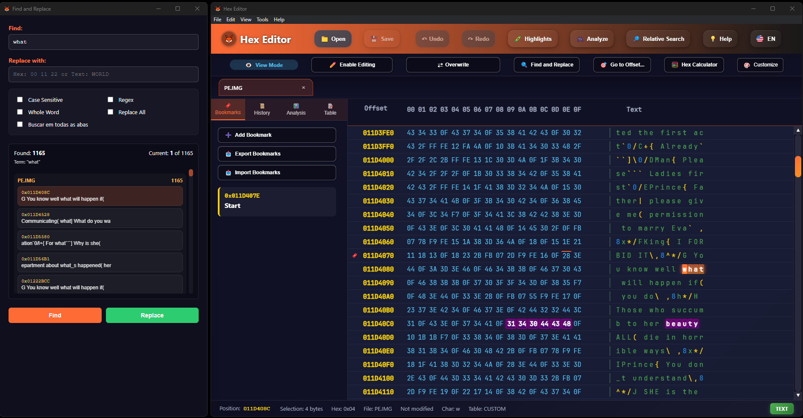
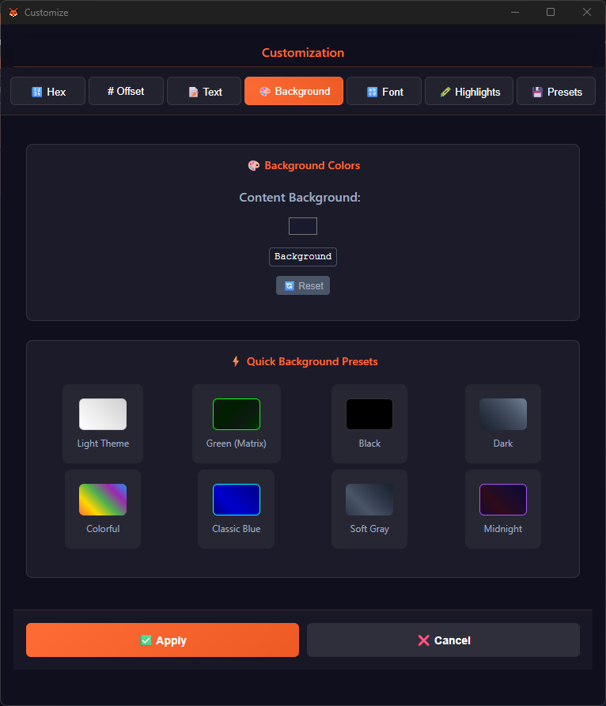
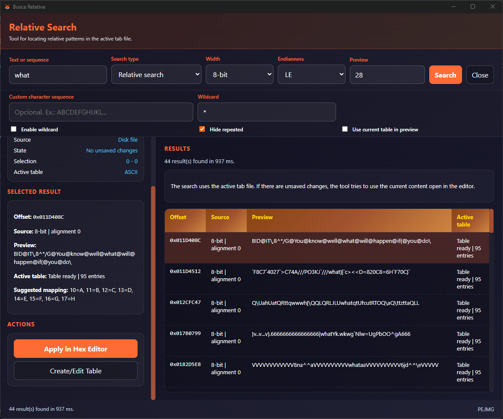
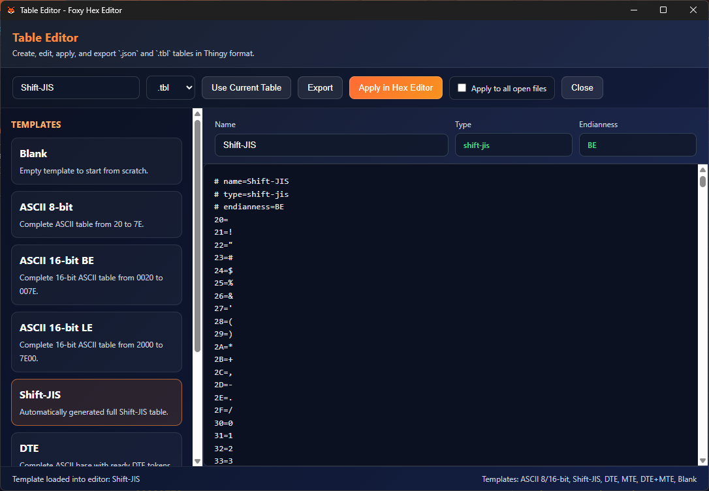

# [🇺🇸 English](README.en.md) | [🇧🇷 Português](README.md)

<p align="center">
  
</p>

<h1 align="center">Foxy Hex Editor</h1>

<p align="center">
  <strong>Editor Hexadecimal para tradução e ROM hacking.</strong>
</p>

<p align="center">
  
  
  
</p>

---



## 📸 Screenshots
<p align="center">
  <br><br>
  <br><br>
  <br><br>
  
</p>

## 🦊 Sobre o Projeto
**Foxy Hex Editor** foi desenhado especificamente para as necessidades das comunidades de tradução e ROM hacking. Desenvolvido com **HTML5, CSS3 e JavaScript** sobre o framework **Electron**, ele combina a precisão da edição binária de baixo nível com uma interface moderna e ferramentas.

## ✨ Destaques
- 🚀 **Portátil**. Um executável para Windows e um AppImage para Linux. O perfil fica em `.foxy-data` ao lado do executável.
- ⚡ **Arquivos grandes**. Leitura sob demanda sem carregar todo o arquivo em memória.
- 🗂️ **Múltiplas Abas**: Trabalhe em diversos arquivos simultaneamente. Cada aba é independente e preserva sua própria tabela de caracteres, favoritos e posição do cursor.
- 🌍 **Mapeamento de Caracteres**: Suporte robusto a tabelas (.tbl e .json) de 8 e 16 bits (BE/LE). Decodifica padrões avançados de ROM hacking como DTE, MTE, Shift-JIS e tags customizadas.
- 🧮 **Calculadora Hex**: Uma ferramenta integrada para cálculos de offsets e conversões rápidas.
- 🔍 **Busca**. Texto e hexadecimal em segundo plano, com cancelamento, busca entre abas e suporte a edições ainda não salvas. A busca por regex tem limites de tamanho.
- 🔍 **Busca Relativa**: Localize textos em arquivos sem codificação padrão (ASCII/Unicode). Identifica padrões baseados na distância numérica entre bytes e auxilia na criação automatizada de tabelas de caracteres (.tbl).
- 📊 **Análise de ROM**: Identifique rapidamente padrões, seções de dados e entropia. Detecta assinaturas de compressão conhecidas (Yaz0, RNC, LZ77, zlib e mais).
- 🎨 **Personalização Completa**: Ajuste cores de fundo, texto e bytes individualmente. Altere fontes e tamanhos para criar um ambiente de trabalho sob medida.

## 💻 Requisitos do Sistema

| Componente                | Requisito Mínimo            | Recomendado                  |
| ------------------------- | --------------------------- | ---------------------------- |
| 🖥️ **Sist. Operacional** | Windows 10 / Linux x64      | Windows 11                    |
| 🏎️ **Processador**       | Dual Core 1.5GHz            | Quad Core 2.0GHz+            |
| 🧠 **Memória RAM**       | 2 GB                        | 4 GB ou mais                 |
| 💾 **Espaço em Disco**   | 200 MB livre                | 500 MB (SSD)                 |
| 🏗️ **Arquitetura**       | x64                         | x64                          |

## 📥 Downloads
Você pode encontrar as versões pré-compiladas na seção de **Releases** do repositório:

- 🪟 **Windows x64**. ZIP com o executável portátil (`.exe`).
- 🐧 **Linux x64**. ZIP com o AppImage.

> [!TIP]
> **[Clique aqui para baixar a versão mais recente](https://github.com/rquinalha/Foxy-Hex-Editor/releases/latest)**

## 🚀 Como Rodar e Configurar

Para garantir que o app funcione perfeitamente no seu sistema:

### 🪟 Windows
1. **Versão Recomendada**: Windows 10 ou superior (64-bit).
2. **Executável**. Baixe o ZIP em **Releases**, extraia o `.exe` e abra-o. O Foxy cria a pasta `.foxy-data` ao lado do executável.
3. **Desenvolvimento**:
   - Instale o [Node.js LTS](https://nodejs.org/).
   - Clone o repo e rode:
     ```powershell
     npm install
     npm start
     ```

### 🐧 Linux
1. Baixe o ZIP em **Releases** e extraia o AppImage x64 em uma pasta com permissão de gravação. Se necessário, torne o arquivo executável antes de abrir. O exemplo usa a v1.1.0.

   ```bash
   chmod +x FoxyHexEditor-1.1.0-linux-x86_64.AppImage
   ./FoxyHexEditor-1.1.0-linux-x86_64.AppImage
   ```

2. Se o AppImage não conseguir montar via FUSE, tente `APPIMAGE_EXTRACT_AND_RUN=1 ./FoxyHexEditor-1.1.0-linux-x86_64.AppImage`. Isso extrai o programa temporariamente. No Ubuntu 24.04, o pacote de compatibilidade do FUSE é `libfuse2t64`. [Guia do FUSE](https://docs.appimage.org/user-guide/troubleshooting/fuse.html)

   Se o terminal indicar um erro de sandbox, consulte a documentação de compatibilidade do AppImage com o Electron. [Guia do sandbox](https://docs.appimage.org/user-guide/troubleshooting/electron-sandboxing.html)

   Se a janela fechar ao iniciar em uma sessão gráfica virtual, tente `./FoxyHexEditor-1.1.0-linux-x86_64.AppImage --disable-gpu`.

3. **Desenvolvimento**:
   - Certifique-se de ter as dependências do Electron instaladas (libnss3, libatk, etc).
   - Clone e rode:
     ```bash
     npm install
     npm start
     ```

## 🛠️ Como Compilar (Build)
Se você deseja gerar seus próprios binários:

1. Instale o [Node.js](https://nodejs.org/).
2. No **Windows**, você pode usar o script facilitador:
   - Execute `build-portable.bat` para gerar `dist\FoxyHexEditor-<versão>-portable.exe` (Windows x64).
   - Distribua apenas o `.exe`. Ao abrir, o Foxy cria `.foxy-data` na mesma pasta e guarda ali as configurações e o cache. Para levar os dados junto, mova o `.exe` e a pasta `.foxy-data` para um local com permissão de gravação.
3. Em **Linux x64** ou **WSL2**, execute `npm ci` e depois `npm run appimage`. Se usar WSL2, faça o build em um clone no sistema de arquivos do Linux. O AppImage sai em `dist/`.

## 🤝 Contribuição
Contribuições são sempre bem-vindas! Sinta-se à vontade para abrir uma *Issue* ou enviar um *Pull Request*.

---

<p align="center">
  Desenvolvido para a comunidade de tradução.
</p>
